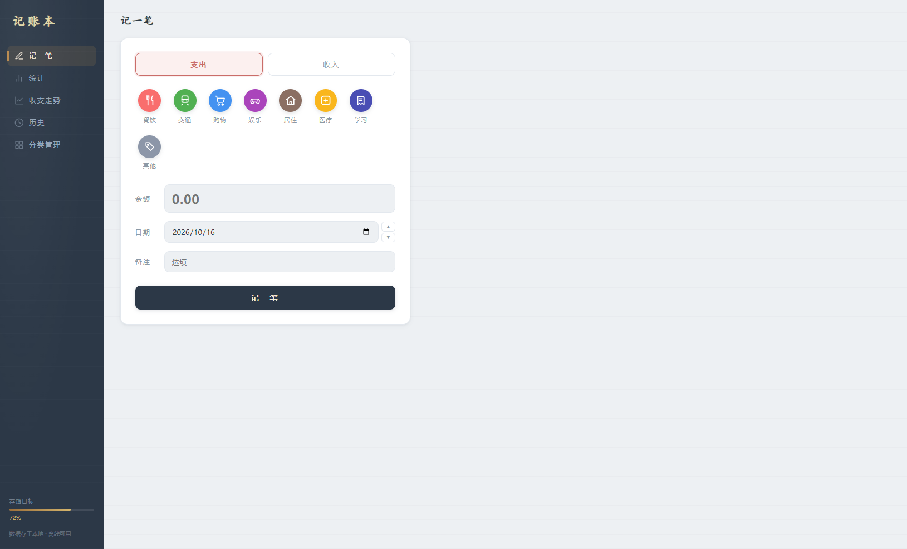
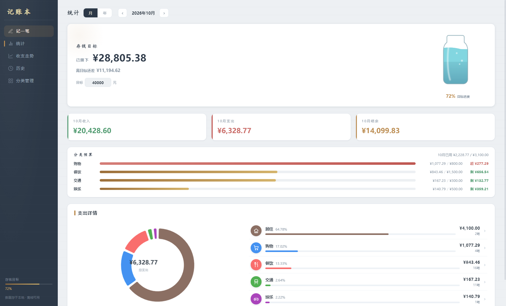
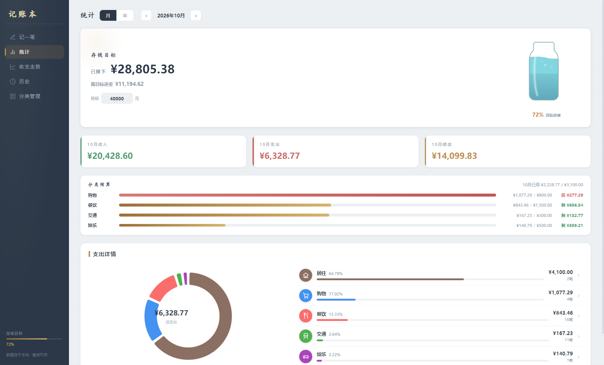
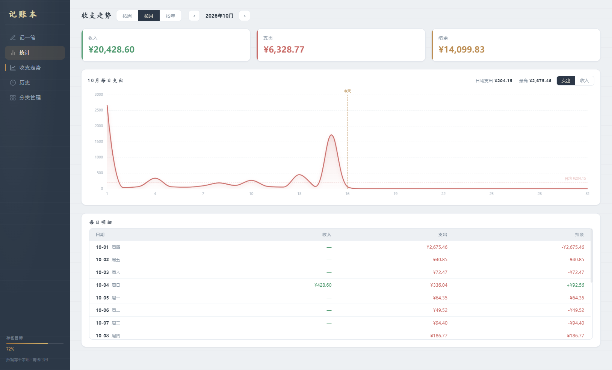
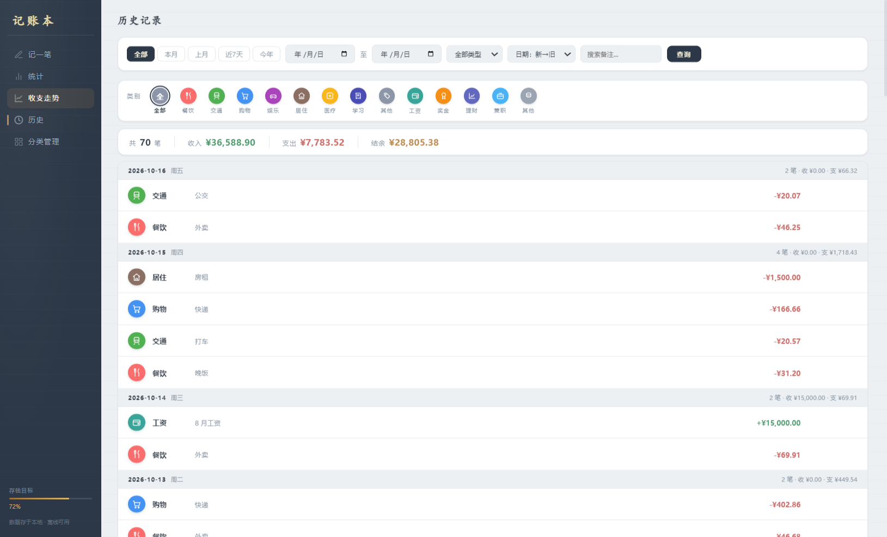

# 记账本

一个本地离线的 Windows 桌面记账应用：**绿色文件夹版，双击即用、数据全在本地**，专为"存够 50 万就离职"这种长期储蓄目标设计。收入/支出随手记，图表看趋势，侧栏有存钱进度，统计页还有一只会慢慢被"存满"的玻璃储蓄罐。

## 截图

| 记一笔 | 统计（存钱目标 + 支出占比 + 分类预算） |
| --- | --- |
|  |  |

| 收支走势 | 历史 |
| --- | --- |
|  |  |

| 分类管理 | |
| --- | --- |
|  | |

## 功能

- **记一笔**：支出/收入二选一，常用分类 + 自定义分类，金额、日期（可前后调）、备注
- **统计**：本月/本年收支汇总、支出分类占比环图 + 排行、分类月预算进度、存钱目标储蓄罐
- **收支走势**：按周/按月/按年切换；默认看支出（可切收入）。周视图柱形、月/年视图面积，图下方附周期明细表
- **历史**：快捷时间范围（全部 / 本月 / 上月 / 近 7 天 / 今年）+ 日期自定义；按类型、**图标类别**筛选；按日期或金额排序；顶部收支汇总，默认按日分组（金额排序时平铺），支持修改、删除
- **分类管理**：内置常用分类，可新增、改名、删除；支出分类可设每月预算
- **存钱目标**：目标金额可改（默认 50 万），按**已攒下**金额计算进度，玻璃储蓄罐加水动画

## 技术栈

| 层 | 选型 |
| --- | --- |
| 桌面框架 | Electron 33 |
| 渲染 | 原生 HTML/CSS/JS（无框架） |
| 图表 | ECharts 5（本地文件，不联网） |
| 存储 | JSON 文件（`data.json`，无原生依赖） |

> 存储为什么用 JSON：最初考虑 better-sqlite3，但目标机器缺 VS Build Tools 编译不了原生模块，换成本地 JSON 文件，对记账数据量完全够用，且真正"绿色便携"。

## 项目结构

```
├── main.js                 # 主进程：窗口、IPC、数据目录决策
├── preload.js              # contextBridge 桥接（隔离环境）
├── store.js                # 数据层：JSON 读写 + 分类/记录/统计
├── 启动记账本.vbs           # 无黑框启动器（相对路径，文件夹拷走可用）
├── renderer/
│   ├── index.html          # 页面结构
│   ├── style.css           # 账本纸面 + 墨蓝晨雾主题
│   ├── app.js              # 渲染逻辑 + ECharts
│   └── echarts.min.js      # 本地图表库
├── screenshots/            # 界面截图（README 引用）
└── build/
    └── icon.ico            # 应用图标（窗口 / 托盘）
```

## 快速开始

```bash
# 安装依赖（需要联网：会下载 Electron 本体）
npm install

# 开发运行
npm start
```

不想动命令行的话，直接双击根目录的 **`记账本` 快捷方式**（带图标）或 **`启动记账本.vbs`** 即可打开应用（**不会闪黑色命令行窗口**）。

### 绿色便携说明

- 本应用**不打包 exe**，以文件夹形式分发：把整个项目文件夹（**连同 `node_modules`**）拷到任意位置，双击 `启动记账本.vbs` 就能用
- 图标与应用内窗口/任务栏图标均为 `build/icon.ico`

## 数据说明（重要）

- 数据默认保存在**程序所在文件夹**的 `data.json`，整个文件夹拷走数据跟着走，不依赖 C 盘、不会弹窗询问
- 如需换位置，可删掉 `data.json` 重新开始，或改 `%APPDATA%\记账本\config.json` 里的 `dataDir`
- 若程序所在目录无写权限，启动时会提示选择可写目录
- `data.json` 包含你的全部账目，**请勿提交到 GitHub**（已加入 .gitignore）

## 许可

仅作个人学习 / 自用开源分享，无商业授权限制。